<picture>
  <source media="(max-width: 600px) and (prefers-reduced-motion: reduce) and (prefers-color-scheme: dark)" srcset="./profile/header-mobile-dark.svg">
  <source media="(max-width: 600px) and (prefers-reduced-motion: reduce)" srcset="./profile/header-mobile-light.svg">
  <source media="(prefers-reduced-motion: reduce) and (prefers-color-scheme: dark)" srcset="./profile/header-dark.svg">
  <source media="(prefers-reduced-motion: reduce)" srcset="./profile/header-light.svg">
  <source media="(max-width: 600px) and (prefers-color-scheme: dark)" srcset="./profile/header-mobile-dark.gif">
  <source media="(max-width: 600px) and (prefers-color-scheme: light)" srcset="./profile/header-mobile-light.gif">
  <source media="(prefers-color-scheme: dark)" srcset="./profile/header-dark.gif">
  <source media="(prefers-color-scheme: light)" srcset="./profile/header-light.gif">
  
</picture>

# 谭俊林 · theHerta27

**西电硕士在读（2028 届）｜AI 全栈开发**

Python · TypeScript · SQL

做 AI 应用，也记录开发中的问题和解决过程。

[项目与实习](#projects) · [技术笔记](#articles) · [常用技术](#stack) · [联系方式](#contact)

## 项目与实习

### 智批 · 智能作业批改平台

**2025.09 — 至今｜系统架构、全栈开发、模型接入与运维**

学生上传手写作业，系统调用团队微调的视觉语言模型进行初步批改，教师复核后发布成绩和报告。我负责业务系统开发、模型服务接入和运维，处理作业提交、后台任务、教师改分和报告更新。

- **全栈开发**：使用 Vue 3、TypeScript、FastAPI 和 PostgreSQL 开发课程、作业、成绩及多角色权限管理。
- **模型与任务**：支持图片/PDF 输入和逐题结构化结果；用 Celery、Redis 处理后台批改，通过检查点、重试和幂等控制恢复中断任务。
- **教师复核**：支持修改评分、确认结果和 PDF 批注报告，按结果版本同步成绩、统计和报告。
- **应用情况**：面向全校开放，覆盖 9 个学院、3000 余名师生，累计处理 2 万余份作业。

[项目介绍](https://herta27.top/projects/#zhipi)

### 广东电信 · 业务知识智能助手

**2025.10 — 2026.01｜AI 应用开发实习生，负责 RAG 检索模块**

参与面向客服和营业厅人员的业务知识助手开发。套餐名称相近、地市政策不同、资料会过期，是检索时需要处理的具体问题。我主要负责知识处理、检索优化和效果评估。

- **知识处理**：解析多格式资料，按内容分块，并保留地域、有效期与来源，支持更新、过滤和原文追溯。
- **检索与评测**：使用 Elasticsearch BM25、BGE-M3、RRF 和 BGE-Reranker；在 1,500 条人工标注业务问答上，Top-5 检索命中率从 78.4% 提升至 92.1%。
- **Agent 接入**：将检索和原文读取封装为工具，加入来源校验、政策有效期检查和低置信度拒答。

[实习项目介绍](https://herta27.top/projects/#rag)

## 技术笔记

- [FastAPI 与 Celery 的任务交接](https://herta27.top/posts/fastapi-background-grading/)
- [批改任务的重试与评分保存](https://herta27.top/posts/job-idempotency-and-results/)
- [RAG 文档分块：保留标题、表格与业务条件](https://herta27.top/posts/rag-chunks-and-metadata/)
- [用 Python 实现 RRF 排名融合](https://herta27.top/posts/rag-hybrid-search-rrf/)
- [RAG 检索评测：Hit、Recall、Precision 和 MRR](https://herta27.top/posts/rag-rerank-and-evaluation/)

更多学习笔记见 [个人博客 herta27.top](https://herta27.top/)。

## 常用技术

- **编程与全栈**：Python · TypeScript · SQL · FastAPI · Vue 3 · SQLAlchemy · PostgreSQL
- **AI 应用与检索**：Tool Calling · MCP · 上下文管理 · 结构化输出 · Elasticsearch · Milvus · BGE-M3
- **后端工程**：Redis · Celery · Docker · Nginx · Linux · Git · pytest
- **AI 辅助研发**：用 Claude Code、Codex 辅助开发、调试与审查，结合自动化测试和 Git Diff 验收改动。
- **语言能力**：CET-6；JLPT N2（136 分，阅读满分）

## GitHub Activity

  <picture>
    <source media="(prefers-color-scheme: dark)" srcset="./profile/stats-dark.svg">
    <source media="(prefers-color-scheme: light)" srcset="./profile/stats.svg">
    
  </picture>
  <picture>
    <source media="(prefers-color-scheme: dark)" srcset="./profile/top-langs-dark.svg">
    <source media="(prefers-color-scheme: light)" srcset="./profile/top-langs.svg">
    
  </picture>

近一年 GitHub 活动与公开仓库语言统计。

## 联系方式

[个人博客 herta27.top](https://herta27.top/) · [1404758168@qq.com](mailto:1404758168@qq.com)
