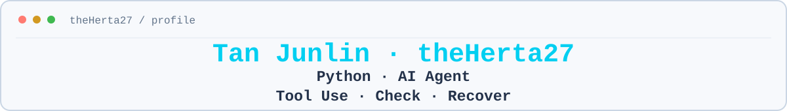

<picture>
  <source media="(max-width: 600px) and (prefers-reduced-motion: reduce) and (prefers-color-scheme: dark)" srcset="./profile/header-mobile-dark.svg">
  <source media="(max-width: 600px) and (prefers-reduced-motion: reduce)" srcset="./profile/header-mobile-light.svg">
  <source media="(prefers-reduced-motion: reduce) and (prefers-color-scheme: dark)" srcset="./profile/header-dark.svg">
  <source media="(prefers-reduced-motion: reduce)" srcset="./profile/header-light.svg">
  <source media="(max-width: 600px) and (prefers-color-scheme: dark)" srcset="./profile/header-mobile-dark.gif">
  <source media="(max-width: 600px) and (prefers-color-scheme: light)" srcset="./profile/header-mobile-light.gif">
  <source media="(prefers-color-scheme: dark)" srcset="./profile/header-dark.gif">
  <source media="(prefers-color-scheme: light)" srcset="./profile/header-light.gif">
  
</picture>

# 谭俊林 · theHerta27

**2028届 · 西安电子科技大学硕士在读（2025.09—2028.06）**

使用 Python、Go、TypeScript，了解 C#、C++，求职方向为 AI Agent 开发实习。围绕工具调用、上下文与记忆、代码检查和任务恢复做项目实践，在个人博客分享开发记录、学习心得和科研探索。

[灰塔](#graytower) · [Herta](#herta) · [精选文章](#articles) · [联系方式](#contact)

## 灰塔

**面向游戏规则的代码修复 Agent · 2026.05—2026.09**

基于 LangGraph 与 LangChain 构建单研发 Agent：定位问题、分析游戏规则代码，在独立 Git 工作树中修改、调用 Docker 检查并根据反馈修订，检查合并结果后由开发者确认合入。

- **代码与检查**：每项任务使用独立分支和 Git 工作树，限制修改范围，对准备合入的代码运行 Docker 检查。
- **人工交付**：审阅后复查版本并快进合入，撤销时新增提交，保留修改历史。
- **状态与记忆**：LangGraph 管理澄清、检查等待和任务恢复；SQLite 保存附来源、版本和确认状态的项目记忆，供后续任务检索。
- **实际任务**：接入 DeepSeek API 修复负数战技点输入，专项 7 项和原规则 99 项通过；工作树合入与撤销用真实 Git/Docker 验证。工程回归 Python 433 项通过、4 项既有跳过，前端 36 项通过。

[公开案例与验证记录](https://herta27.top/posts/graytower-agent-case-study/) · [GitHub 源码](https://github.com/theHerta27/graytower-agent)

## Herta

**轻量级 CLI Coding Agent · 2026.04—2026.07**

基于 Python 实现轻量级 Agent Harness，支持模型自主选择工具，完成代码检索、文件编辑与测试。程序负责工具参数校验、人工审批、上下文管理与会话恢复。

- **工具与审批**：注册 5 个工具，用 Pydantic 定义参数并校验输入；结合 diff 与 SHA-256 核对待执行内容，对有副作用的操作逐次审批。
- **上下文与恢复**：按完整轮次管理上下文并估算 Token，用 SQLite 保存和恢复会话，不重放已执行的工具操作。
- **真实任务**：接入 DeepSeek API，完成购物车结算修复与字频工具 JSON 输出开发，两项任务分别通过 7 项、8 项测试，并由独立检查器核对结果。
- **验证范围**：120 项 CLI 与检查器测试通过，另有 4 项 Windows 启动测试通过；保留拒绝操作、编辑冲突检测与会话中断恢复的验证记录。

[公开案例与验证记录](https://herta27.top/posts/herta-cli-case-study/) · [真实任务演示](https://herta27.top/demos/#herta) · [GitHub 源码](https://github.com/theHerta27/herta-agent)

## 精选文章

- [Herta：工具调用与执行审批](https://herta27.top/posts/herta-tool-call/)
- [Herta：恢复会话时如何避免重复执行](https://herta27.top/posts/herta-session-resume/)
- [灰塔：让检查结果对应候选代码版本](https://herta27.top/posts/graytower-check-version/)
- [灰塔：用 LangGraph 管理研发 Agent 的循环与恢复](https://herta27.top/posts/graytower-langgraph-loop/)
- [项目记忆：来源、版本与人工确认](https://herta27.top/posts/graytower-project-memory/)

更多工程记录见 [个人博客 herta27.top](https://herta27.top/)。

## 技术

- **编程语言**：Python · Go · TypeScript；了解 C#、C++
- **Agent 开发**：LangGraph · LangChain · Pydantic · Tool Calling · 上下文管理 · 项目记忆
- **工程与验证**：Python asyncio · Git Worktree · Docker · SQLite · Linux · 自动化测试
- **语言能力**：CET-4/6 · JLPT N2（阅读满分、排名前4.8%）

## GitHub Activity

  <picture>
    <source media="(prefers-color-scheme: dark)" srcset="./profile/stats-dark.svg">
    <source media="(prefers-color-scheme: light)" srcset="./profile/stats.svg">
    
  </picture>
  <picture>
    <source media="(prefers-color-scheme: dark)" srcset="./profile/top-langs-dark.svg">
    <source media="(prefers-color-scheme: light)" srcset="./profile/top-langs.svg">
    
  </picture>

贡献数取自 GitHub 近一年统计，其他数据来自公开仓库；语言占比反映仓库构成，不代表熟练程度。

## 联系方式

[个人博客 herta27.top](https://herta27.top/) · [1404758168@qq.com](mailto:1404758168@qq.com)
